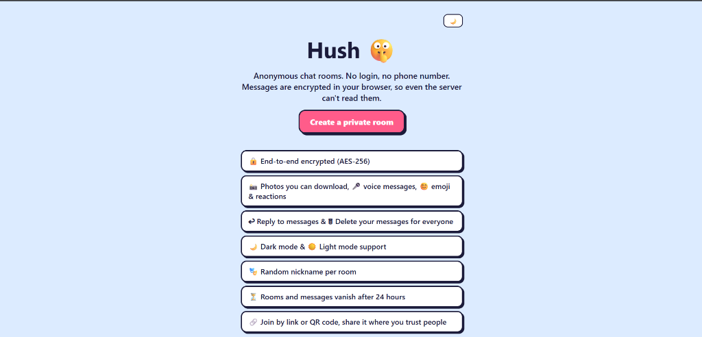
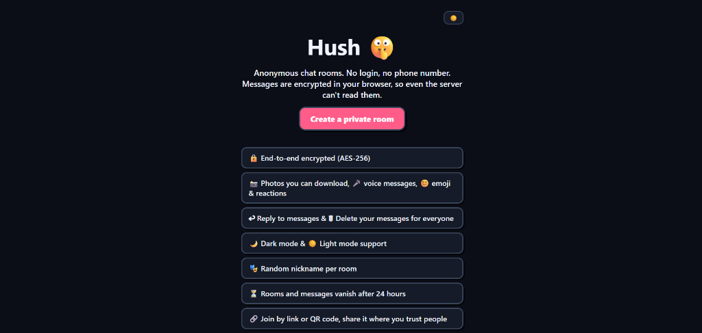
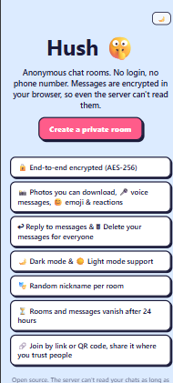

# Hush 🤫

Anonymous end-to-end-encrypted chat rooms in your browser, no login, no phone number.

[](LICENSE)
[](https://nodejs.org)
[-orange.svg)](#)

[Live demo](ADD_LINK_HERE)

---

## Screenshots

| Light Mode | Dark Mode | Mobile View |
| :---: | :---: | :---: |
|  |  |  |

---

## Features

### 🔒 Privacy
- **Client-Side AES-256-GCM**: Encryption happens in the browser via native Web Crypto.
- **Key Stays in `#` Fragment**: The room key is in the URL `#` hash and is never sent to the server.
- **Zero Database**: Rooms, messages, and media exist in server memory only; restart wipes everything.
- **Strict CSP**: Zero inline scripts, zero inline styles, no external CDNs, no tracking cookies.

### 💬 Chat
- **Encrypted Text**: Messages up to 1,000 characters with markdown-safe text rendering.
- **Quoted Replies**: Quote messages with matching author hue and click-to-jump with pulse animation.
- **Typing Indicator**: Real-time "typing…" hints (encrypted, ephemeral, never stored in history).
- **History for Late Joiners**: Last 200 messages preserved in memory during room lifetime.

### 📸 Media & Attachments
- **Photo Sharing**: Client canvas auto-resizes to JPEG and strips EXIF/GPS metadata.
- **Photo Lightbox**: Fullscreen modal viewer with direct download link.
- **Interactive Voice Player**: Custom player with audio waveform amplitude bars, seek scrubber, 1x/1.5x/2x playback speed toggle, and save button.
- **Encrypted File Attachments**: Share confidential PDFs, documents, text files, and archives up to 1.5 MB with dedicated file card and download button.
- **Voice Notes & Recording**: Opus audio via MediaRecorder (up to 2 minutes) with live "recording…" indicator.

### ✨ Fun & Interactive
- **Encrypted Anonymous Polls**: Create encrypted multi-option polls (2 to 5 options); room members cast encrypted votes with live updating percentage bars and vote counters.
- **Turn-Based Mini-Games**: Challenge room members to encrypted turn-based Tic-Tac-Toe directly in chat with real-time board updates and winner detection.
- **Real-Time WebRTC P2P Voice Call**: Browser-to-browser voice calling directly peer-to-peer (media never touches the server), with encrypted signaling relay over Socket.io.
- **24 Built-in Vector Stickers**: SVG packs across Reactions, Love, Funny, and Words with search.
- **Make-Your-Own Stickers**: Square crop & WebP under 100 KB, saved in local IndexedDB (up to 60).
- **Emoji Picker & Reactions**: 6 emoji categories, quick reaction row (👍, ❤️, 😂, 😮, 😢, 🙏), and counter chips.
- **Random Animal Nicknames**: Colorful anonymous animal names with deterministic HSL avatar colors.

### 🛡️ Room Control
- **Delete for Everyone**: Author (`delToken`) or room creator (`adminToken`) can delete messages in real-time.
- **Creator Room Destruction**: One-click destruction by creator drops media and disconnects all sockets.
- **24-Hour Expiration**: Background sweeper automatically purges expired messages and idle rooms.
- **Room Nickname Rename**: Change your display name locally for the room at any time.

### 🎨 App Feel
- **Theme Switcher**: Instant dark and light mode toggle with system preference synchronization.
- **Zero-Flash Theme Init**: Classic script in `<head>` applies theme before CSS paints.
- **QR Code Invites**: Built-in client QR generator for mobile camera scanning.
- **Invite Sharing**: Native Web Share API integration with automatic clipboard fallback.

---

## How the Encryption Works

When a room is created, the browser generates an `AES-256-GCM` key using Web Crypto. The key is placed in the URL `#` fragment (`/r/<id>#<key>`), which browsers never transmit over HTTP or WebSockets.

```
[Sender Browser]                            [Relay Server]                           [Recipient Browser]
       │                                           │                                           │
1. Encrypts payload with key in #fragment          │                                           │
   AES-256-GCM -> {iv, ct}                         │                                           │
       │                                           │                                           │
       │─────── socket.emit('msg:send', {iv, ct}) ─>│                                           │
       │                                           │── io.to(room).emit('msg', {id, iv, ct}) ──>│
       │                                           │                                           │
       │                                           │                                  2. Decrypts with key in #fragment
       │                                           │                                     AES-256-GCM -> plaintext
```

Each message and media attachment receives a fresh, random 12-byte IV. The server only relays ciphertext.

---

## Honest Limits & Threat Model

- **Invite Link Access**: Anyone with the full link (including the `#` fragment) can read the room.
- **Malicious Server Operator**: A compromised server could serve tampered JavaScript. Keep the code small and auditable, or self-host.
- **Metadata Visibility**: The server sees IP addresses, connection times, member counts, and packet sizes.
- **Nickname Forgery**: All room participants share the room key; nicknames are for chat clarity, not identity verification. Destructive actions (`msg:delete`, `room:destroy`) use separate random secret tokens.
- **No Forward Secrecy**: If a room key is leaked, past intercepted messages can be decrypted.
- **View-Once Limitation**: Any client that can display a message can capture it.

For full cryptographic analysis and threat model, see [SECURITY.md](SECURITY.md).

---

## Quick Start

```bash
git clone https://github.com/Adarshhspeaks/hush.git
cd hush
npm install
npm start
```

Open `http://localhost:3000` in your browser.

> [!NOTE]
> Web Crypto requires a secure context: `localhost` or `https`. Accessing the server over a local network IP on plain `http://` will disable Web Crypto.

---

## Deploy on Render

1. Link your GitHub fork to [Render](https://render.com) as a **Web Service**.
2. **Build Command**: `npm install`
3. **Start Command**: `npm start`
4. Set optional environment variables:

| Variable | Default | Description |
|---|---|---|
| `PORT` | `3000` | Port to listen on |
| `ROOM_MEDIA_CAP` | `12000000` (12 MB) | Max media ciphertext stored per room before oldest is dropped |
| `GLOBAL_MEDIA_CAP` | `120000000` (120 MB) | Max media ciphertext stored across whole server |

Render provisions free HTTPS, enabling Web Crypto and microphone permissions on mobile browsers.

---

## Project Structure

```
hush/
├─ server/           # Express app, security headers, in-memory store, socket handlers
├─ public/           # Static frontend files served directly to browser
│  ├─ assets/        # Built-in SVG sticker assets
│  ├─ css/           # Modular stylesheets (theme, base, layout, messages, composer, overlays, stickers)
│  ├─ js/            # Client ES modules (core, messages/kinds, features, pages, theme-init)
│  └─ vendor/        # Third-party dependencies (qrcode.mjs)
├─ tests/            # Automated test suite (node:test) covering all protocol contracts
└─ docs/             # Architecture overview, extension guides, and screenshot assets
```

---

## Limits

| Parameter | Limit | Description |
|---|---|---|
| **Message Text** | 1,000 characters | Ciphertext envelope capped at 4,096 chars |
| **Media File** | ~1.5 MB | Compressed photo (JPEG) or voice note (Opus) |
| **Custom Sticker** | 100 KB | WebP/PNG square crop, max 60 per browser |
| **Room Media Cap** | 12 MB | Oldest media dropped first when cap exceeded |
| **Global Media Cap** | 120 MB | Server memory guard against media exhaustion |
| **Room Expiry** | 24 hours | Messages and empty rooms vanish after 24h |
| **Room Capacity** | 50 users | Maximum concurrent socket connections per room |
| **Rate Limit** | Burst 5, refill 2.5/s | Token bucket per socket (media costs 3, text costs 1) |

---

## Contributing & Audit

Hush is kept small and dependency-light so anyone can audit the code:
- Read [PROTOCOL.md](PROTOCOL.md) and [server/](server/) to verify the server never sees plaintext.
- Run tests: `npm test`

Issues and pull requests are welcome on GitHub.

---

## License & Author

- **Author**: Adarsh Kumar ([@Adarshhspeaks](https://github.com/Adarshhspeaks))
- **License**: [MIT](LICENSE)
